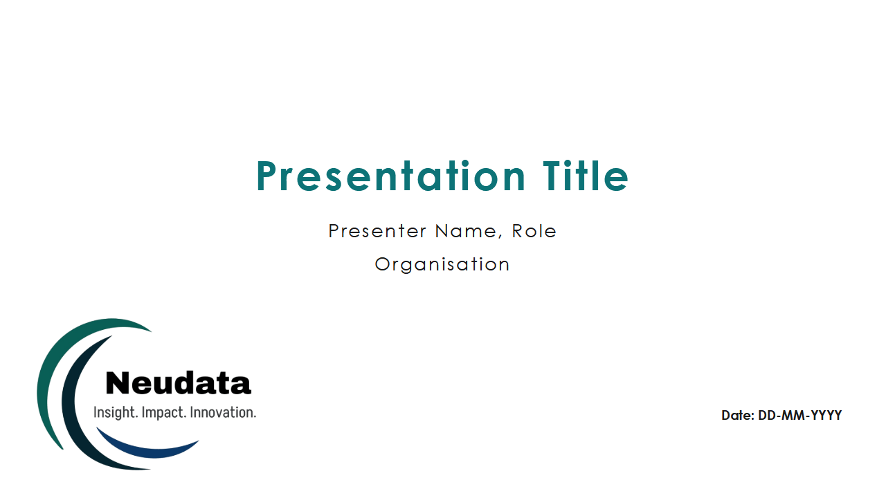
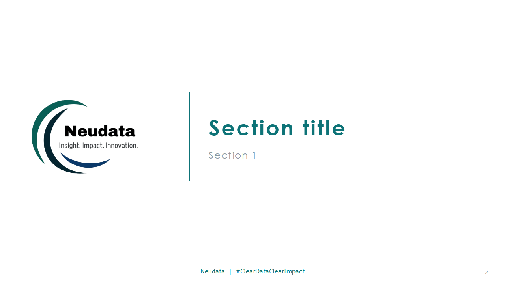
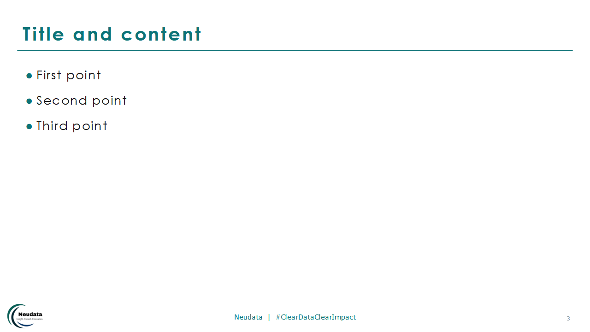

<div align="center">


# Neudata PowerPoint template

**The Neudata slide master and layouts as a reusable PowerPoint template (`.potx`).**


</div>

---

| | | |
|---|---|---|
|  |  |  |

## Download

- **[Neudata-Template.potx](Neudata-Template.potx)** — the template
- [Neudata-Template-example.pptx](Neudata-Template-example.pptx) — one example slide per layout

## Install so it appears under *File → New*

1. Download `Neudata-Template.potx`.
2. Save it to your personal templates folder:
   - **Windows:** `Documents\Custom Office Templates`
   - **Mac:** `~/Library/Group Containers/UBF8T346G9.Office/User Content/Templates`
3. In PowerPoint: **File → New → Personal** (or *Custom*) → **Neudata-Template**.

Or simply double-click the `.potx` to start a new presentation from it.

To restyle an existing deck: **Design → Themes → Browse for Themes…** → choose the `.potx`.

## Layouts

| Layout | Use for |
|---|---|
| **Title Slide** | Opening slide: title, presenter, large logo, date |
| **Section Header** | Section dividers |
| **Title and Content** | Standard bulleted slides |
| **Title and Notes** | Title with blue note text |
| **Two Content** | Side-by-side columns |
| **Title Only** | Charts, tables, diagrams |
| **Blank** | Full-bleed visuals (logo, footer and number kept) |
| **Closing – Copyright** | Final slide with the Neudata copyright notice |

Every content layout carries the small logo, the `Neudata | #ClearDataClearImpact` footer and the slide number, so they never need to be copied by hand. Insert slide numbers with **Insert → Slide Number** if they are switched off.

## Theme

- **Colours** (Design → Variants → Colors → *Neudata*): teal `#0D7377`, blue `#0070C0`, deep teal `#055F56`, logo blue `#0B376C`, light teal `#5FA39B`, grey `#8A99A3`; navy `#04242F` and mist `#EAF2F5` as dark/light 2
- **Fonts:** Century Gothic (headings and body), Verdana (footer)

Charts and tables inserted in PowerPoint pick up the Neudata colours automatically.

## Rebuilding

The template is generated by [`build-template.ps1`](build-template.ps1) (PowerPoint on Windows + Python):

```powershell
powershell -ExecutionPolicy Bypass -File build-template.ps1
```

---

<div align="center">

**Neudata Consulting Ltd** · *Insight. Impact. Innovation.*
[www.neu-data.com](https://www.neu-data.com) · [contact@neu-data.com](mailto:contact@neu-data.com)

</div>
